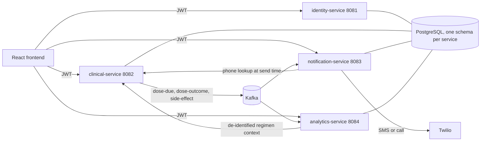
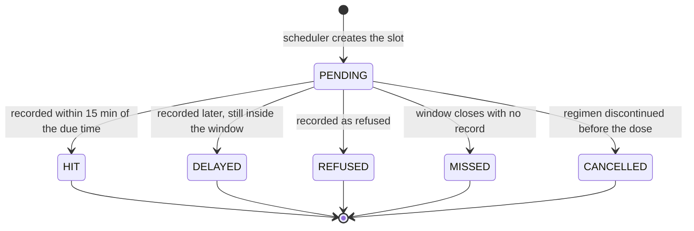

# AdhereLens

A cross-hospital medication adherence platform. Hospitals schedule doses, nurses and automated reminders push each dose to be taken inside a time window, every outcome is recorded, and a de-identified analytics layer shows adherence and side-effect patterns across days of therapy, drugs and hospitals.

Built with Java 21, Spring Boot 3.2, PostgreSQL 16, Apache Kafka and a React + TypeScript frontend.

> **Data note:** all analytics screens run on synthetic data. No real patient data is used. The analytics are descriptive (SQL aggregation), not predictive.

## How it works

1. A hospital admin registers staff and patients. A doctor prescribes a **regimen** (drug, dose, daily times, grace window).
2. Every day a scheduler turns each regimen into **dose slots** and publishes a `dose-due` event.
3. **Inpatients:** an alert appears for the nurses. **Outpatients:** the patient gets up to three bounded SMS or call reminders (for example at due time, +15 min, +30 min), never outside the dose window. Each SMS carries a signed one-time link for that exact dose (see below).
4. A nurse or doctor records the dose as given or refused. An outpatient can also confirm it from the SMS link. If nobody records it before the window closes, the system marks it **MISSED**.
5. Each final outcome is published as a `dose-outcome` event. The analytics service de-identifies it and stores it for reporting.

Roles: `PLATFORM_ADMIN`, `HOSPITAL_ADMIN`, `DOCTOR`, `NURSE`. A hospital only ever sees its own data.

## Architecture



| Service | Owns |
|---|---|
| `identity-service` | hospitals, staff, login, JWT issuing |
| `clinical-service` | patients, regimens, dose slots, drug rules, side effects, audit trail, the scheduler |
| `notification-service` | nurse alerts, outpatient reminders, SMS/call sending |
| `analytics-service` | de-identified dose and side-effect facts, adherence statistics |

### Why microservices here

The split follows a privacy boundary, not a wish for more services. Patient names, phone numbers and dates of birth live only in `clinical-service`. The other services hold ids and coded values, so they cannot leak what they never had. The cost is real: extra internal calls (contact lookup, analytics context), eventual consistency, and one shared Postgres server and JWT secret. Separate databases would be the next step.

## The dose lifecycle



- Recording a dose is rejected if it is not due yet, the window has closed, or it already has an outcome.
- Each slot has a `@Version` column. If the scheduler (MISSED) and a nurse (HIT) save the same slot at once, the second save fails with `409` instead of overwriting.
- A slot is created only while its window is still open. After an outage, doses whose window already passed are left out rather than counted as MISSED, so downtime is not blamed on patients.
- `taken rate = (HIT + DELAYED) / final doses`, `on-time rate = HIT / final doses`.

## Outpatient confirmation by signed link

Each outpatient SMS ends with a link such as `https://<host>/d/<token>`. The page needs no login: the patient sees the drug and the dose window and taps **I took it** or **I did not take it**.

- **Token:** `{doseSlotId}.{expiryEpochSeconds}.{HMAC-SHA256}`. It is stateless, tied to one dose slot, and expires when that slot's window closes. The signing key (`DOSE_LINK_SECRET`) is separate from the JWT secret and lives only in `clinical-service`.
- **One dose, not a guess:** two medicines due at 08:00 get two different links, so the system never has to work out which one a reply meant.
- **Same rules as a nurse:** the link calls the same recording code, so the HIT/DELAYED boundaries, the window check and the `@Version` conflict check all apply. The slot stores `reported_by_role = PATIENT` and no staff id.
- **Single use:** the slot rejects a second outcome, so a reused link only shows the result.
- **Outpatient only:** inpatient doses and doses that already have an outcome never get a link, and a valid token for an inpatient slot is refused.
- **Delivery is still SMS through the gateway,** so no inbound webhook is needed. If the link cannot be fetched at send time, the plain reminder goes out without it. Call reminders cannot carry a link.
- **Responses:** forged or malformed token gives 404, expired gives 410, and the page shows no patient name.

## Reliability: what is guaranteed and how

| Problem | Approach |
|---|---|
| Events delivered twice | Kafka is at-least-once. Consumers are idempotent, keyed on `doseSlotId`: unique constraints in notification, `ON CONFLICT` upserts in analytics. |
| Publish fails after the DB write | The scheduler sends, waits for the broker ack, then sets a `published` flag. A failed send is retried on the next tick. |
| Events arrive out of order across two topics | `slot_outcomes` remembers finished slots, so a late `dose-due` is ignored. |
| Duplicate slot generation | `UNIQUE (regimen_id, due_at)` as the backstop. |
| Several instances running the scheduler | Every scheduler step locks its row with `SELECT ... FOR UPDATE SKIP LOCKED`. An instance skips rows another instance holds. |
| Reminder send fails | Retry with exponential backoff (30 s, 60 s), at most 3 tries, never past the dose window, then `FAILED`. |
| Network call while holding a DB lock | Reminders are sent in three steps: claim (short transaction), send (no transaction), record the result (short transaction). |
| Instance dies mid-send | A claim older than 2 minutes returns to `PENDING`. Worst case is one duplicate message, never a lost one. |
| Dose recorded while a reminder is in flight | The outcome cancels open reminders, including ones being sent, so a late result cannot revive them. |
| Silent history rewrites | `regimen_audit` is append-only, enforced by a Postgres trigger. |

## Privacy and security

- **Ids only across services.** Notification fetches the phone number from clinical at send time and never stores it. Failure records keep only an exception class name, because error messages can contain numbers.
- **De-identification in analytics:** patient ids become keyed hashes (HMAC-SHA256), age becomes a 10-year bucket, drugs and conditions are coded values, and any group with fewer than 5 distinct patients is suppressed in every result.
- **Auth:** stateless JWT. `hospitalId` always comes from the verified token, never from the request, and every repository query filters by it. URL rules and `@PreAuthorize` apply together.
- **Internal endpoints** use a shared key compared in constant time.
- **Dose links:** anyone holding a link can answer for that one dose until its window closes, so treat the SMS like the patient's own phone. The public endpoint has no rate limiting yet.
- **Secrets** come from environment variables only. The services refuse to start without them. See `.env.example`.

This is privacy-by-design, not a legal compliance claim. It has not been reviewed for HIPAA, DPDP or similar rules.

## Run it locally

Prerequisites: JDK 21, Maven 3.9+, Docker, Node 18+.

```bash
./dev.sh start     # builds, starts Postgres + Kafka (Docker), the 4 services and the frontend
./dev.sh status
./dev.sh logs clinical     # identity | clinical | notification | analytics | frontend
./dev.sh stop
```

The first run creates a git-ignored `.env` with random secrets. Open http://localhost:5173 and log in as the platform admin. The email and password are in `.env` (`BOOTSTRAP_ADMIN_EMAIL`, `BOOTSTRAP_ADMIN_PASSWORD`).

If you started an older version of this project before, the Postgres volume still has the old password. Run `docker compose down -v` (this deletes local data) or set `DB_PASSWORD=adherelens` in `.env`.

Health checks: `GET /actuator/health` on ports 8081 to 8084.

To run one service from Maven, load the environment first:

```bash
set -a; source .env; set +a
mvn -q install -DskipTests          # once, so the shared modules are available
mvn -pl clinical-service spring-boot:run
```

The dose link in each SMS points at `PUBLIC_BASE_URL` (default `http://localhost:5173`). Set it to an address the patient's phone can reach, for example the forwarded Codespaces URL when you test with a real phone. `dev.sh` adds `DOSE_LINK_SECRET` to an existing `.env` if it is missing.

SMS and calls are log-only by default. To use Twilio set the `TWILIO_*` variables in `.env` and `adherelens.twilio.enabled=true` in `notification-service`.

## Tests

```bash
mvn test
```

JUnit 5 and Mockito unit tests cover the dose recording rules (including the HIT/DELAYED time boundaries), slot creation, the scheduler steps, the skip-if-locked behaviour, event publishing, missed-dose detection, the reminder claim, retry and backoff logic, and the signed dose link (signature, tampering, expiry, outpatient-only, patient confirmation). They mock the database, so row locking itself was checked by hand with two running instances, not by an automated test.

## Project layout

```
common/                shared event records and enums
auth-common/           JWT verification filter shared by all services
identity-service/      hospitals, staff, login
clinical-service/      patients, regimens, dose slots, scheduler
notification-service/  alerts, reminders, SMS/call gateway
analytics-service/     de-identified facts and statistics
frontend/              React + TypeScript (Vite), hand-built SVG charts
docker-compose.yml     Postgres and Kafka for local development
dev.sh                 one-command local run
```

## Known limitations

- Patient confirmation needs a smartphone with internet. There is no reply-by-SMS fallback for basic phones, and call reminders cannot carry a link.
- The public link endpoint has no rate limiting, and a forwarded link works for whoever holds it.
- The link flow is unit tested, but no automated test drives the real HTTP endpoint end to end.
- The Twilio gateway is implemented but has not been run against a live account.
- Side-effect events are published after commit without retry. A crash at that moment loses the event. An outbox table would fix it.
- The analytics consumer retries for about a minute, then skips the event. There is no dead-letter topic.
- A Kafka send happens while the slot's row lock is held, for up to 10 seconds. Only that one slot is blocked.
- A crash after an SMS is sent but before the result is recorded can send the reminder twice.
- Doses whose window closed during an outage are absent from the data, not marked missed.
- Kafka topics have one partition, and all services share one Postgres server and one JWT secret.
- No integration tests against a real database and no CI pipeline yet.
- The hospital API key is generated and stored hashed but not yet used for authentication.

## Scaling path

The scheduler already runs safely on several instances because of `SKIP LOCKED`. If volume grows: add partitions to the topics (messages are keyed by patient), publish through an outbox table instead of polling flags, and move the services to separate databases. Kafka is already in place, so the notification senders can become independent consumers without redesign.
